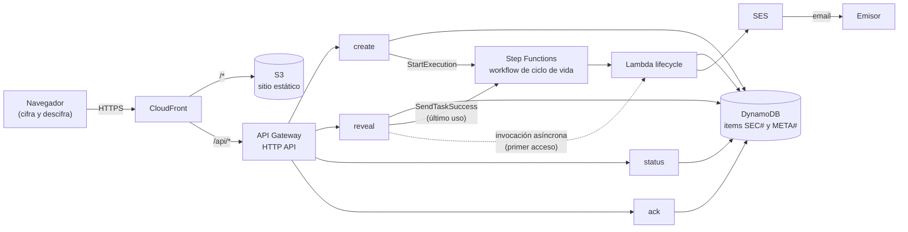
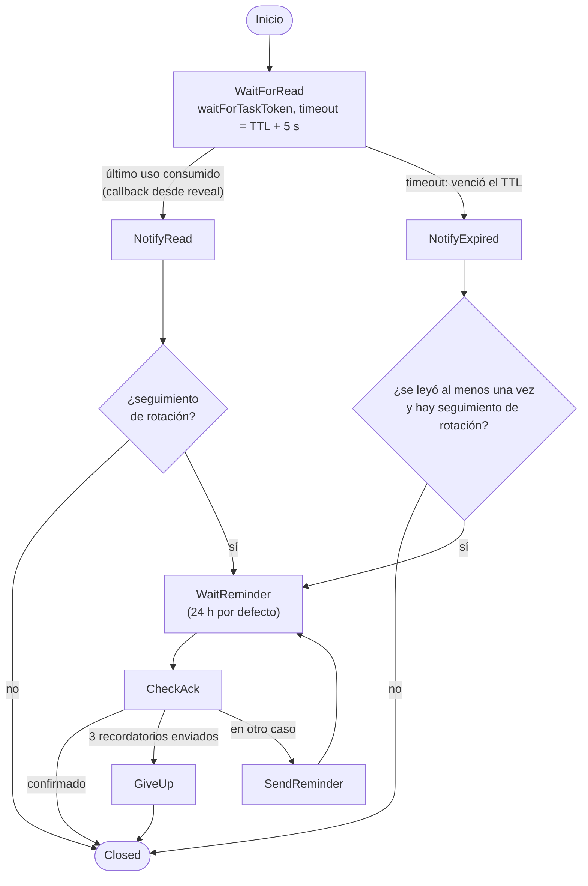

# Cirrus — secretos que se disipan

[English](README.md) · **Español**

> Comparte credenciales cifradas en tu navegador. Cirrus no se detiene en el link: te avisa cuando el secreto se leyó y te sigue recordando rotar la credencial hasta que lo confirmes.

Construido para el reto serverless de AWS Builder Center. Todo corre sobre servicios administrados: **Lambda, API Gateway, DynamoDB, Step Functions, S3, CloudFront y SES**. No hay servidores que parchear, ni pipelines que mantener, y nada corre (ni cobra cómputo) mientras está inactivo.

## Por qué Cirrus

Las herramientas de secretos de un solo uso resuelven la mitad del problema: hacen que el *link* muera tras una lectura. Pero cuando un ingeniero de soporte envía una access key de IAM, el JSON de una service account o un archivo `.env`, **la credencial sigue válida** en la cuenta de origen, a menudo durante meses.

Cirrus cierra ese ciclo. Reconoce lo que compartes, te advierte sobre credenciales de larga duración y usa un workflow de Step Functions para seguir el secreto durante toda su vida: primer acceso, última lectura o expiración, checklist de rotación, recordatorios y confirmación.

## Funcionalidades

| Área | Qué hace |
|---|---|
| **Zero-knowledge** | Cifrado AES-GCM de 256 bits en el navegador (WebCrypto). La clave viaja solo en el fragmento de la URL (`#`), que los navegadores nunca envían a un servidor. El backend guarda únicamente texto cifrado. |
| **Multiuso atómico** | De 1 a 5 usos por link. Cada lectura es un único `UpdateItem` condicional en DynamoDB, así que 10 peticiones simultáneas contra un secreto de 3 usos dan exactamente 3 éxitos. |
| **Expiración real** | De 1 minuto a 7 días. La expiración se comprueba contra `expiresAt` en la condición de lectura y nunca depende del TTL de DynamoDB (que puede tardar horas). |
| **Links a prueba de escáneres** | Abrir un link solo carga una página estática con un botón *Revelar*. El secreto se consume con un `POST` disparado por el clic, así que los escáneres de seguridad del correo que abren los links no lo queman. `GET /info` es de solo lectura. |
| **Detección de credenciales** | Totalmente en el cliente. Reconoce access keys de AWS (`AKIA…`) y credenciales temporales (`ASIA…`), JSON de service accounts de GCP, client secrets de Azure, tokens de GitHub y Slack, claves privadas PEM, cadenas de conexión y archivos `.env`. Muestra una advertencia, una alternativa más segura y un TTL por defecto más corto. |
| **Seguimiento del ciclo de vida** | Avisos por email opcionales: primer acceso (links multiuso), última lectura, expiración. El seguimiento de rotación, también opcional, añade un checklist por proveedor, hasta 3 recordatorios y una página de confirmación. |
| **Página de estado** | El emisor ve las lecturas (con hora), los recordatorios y el estado de la rotación, nunca el contenido. |
| **Extras opcionales** | Passphrase para un segundo canal (PBKDF2-SHA256, 600 000 iteraciones) y una referencia de caso en texto plano (`CASE-12345`) que se muestra en los correos y las páginas. |
| **Web endurecida** | CSP estricta (`script-src 'self'`, sin código en línea, sin recursos de terceros, fuente alojada localmente), `nosniff`, `no-referrer`, HSTS y `X-Frame-Options: DENY`. |

## Arquitectura



El sitio y la API comparten un mismo origen: CloudFront envía `/api/*` a API Gateway, por lo que no hace falta configurar CORS.

| Servicio | Rol |
|---|---|
| **S3 + CloudFront** | Frontend estático por HTTPS (WebCrypto exige un contexto seguro), punto de entrada único y cabeceras de seguridad. El bucket es privado (origin access control). |
| **API Gateway (HTTP API)** | Endpoints públicos con throttling. |
| **Lambda** (Node.js 22, arm64) | `create`, `reveal`, `status`, `ack` y una función `lifecycle` con varias acciones. |
| **DynamoDB** (bajo demanda) | Una sola tabla, con limpieza por TTL. |
| **Step Functions (Standard)** | Orquesta el ciclo de vida: espera la lectura sin polling y luego repite recordatorios hasta que se confirma. |
| **SES** | Correos de notificación (HTML y texto plano). |

## Cómo funciona

### Crear y revelar

1. El navegador detecta el tipo de credencial, genera una clave aleatoria de 256 bits, cifra y hace `POST` solo de `ct`, `iv`, el TTL y el número de usos. Con passphrase, el texto plano se cifra primero con una clave derivada con PBKDF2 y luego se envuelve con la clave aleatoria.
2. El link es `https://<sitio>/reveal.html#<id>:<clave>`. Nada de lo que va después del `#` llega al servidor en una petición normal.
3. El receptor abre el link, ve los usos restantes (`GET /info`, solo lectura) y pulsa *Revelar*. La Lambda `reveal` ejecuta un único `UpdateItem` condicional: solo tiene éxito si el item existe, no expiró y quedan usos. El último uso también borra el texto cifrado.
4. El navegador descifra localmente con la clave del fragmento.

### El workflow de ciclo de vida

Si el emisor activa el seguimiento, `create` inicia una ejecución de Step Functions por secreto.



- **Sin polling.** El workflow espera con el patrón `.waitForTaskToken`. `reveal` llama a `SendTaskSuccess` cuando se consume el último uso; si el TTL llega antes, la tarea vence por timeout y se ejecuta la rama de expiración.
- **Caso borde resuelto.** Si el secreto se consume antes de que se guarde el task token, `register` lo detecta y completa la tarea por su cuenta.
- **Reintentos.** Cada tarea reintenta los errores transitorios del servicio Lambda (3 intentos, con backoff exponencial), de modo que una invocación limitada o no disponible no termina el workflow en silencio.
- **Acotado.** Como máximo 3 recordatorios y un aviso final; la ejecución siempre termina.

¿Cuándo sale un correo?

| Situación | Correos al emisor |
|---|---|
| Primer acceso de un link multiuso | Un aviso "alguien abrió tu secreto" (idempotente) |
| Se consume el último uso | Aviso de lectura; con seguimiento de rotación: checklist, hasta 3 recordatorios y un aviso final si no se confirma |
| Expira con lecturas | "Expiró con N de M lecturas"; con seguimiento de rotación: checklist y recordatorios |
| Expira sin leerse | Un aviso "expiró sin leerse" |
| No se pidió seguimiento | Ninguno, y no se inicia ninguna ejecución |

Los checklists de rotación incluyen los comandos exactos del proveedor detectado (por ejemplo `aws iam update-access-key … --status Inactive`, o `gcloud iam service-accounts keys disable …`).

## Modelo de datos

Una tabla de DynamoDB, clave de partición `pk`, atributo TTL `ttl`.

| Item | Contenido |
|---|---|
| `SEC#<id>` (se borra en la última lectura) | `ct`, `iv`, `maxUses`, `usesLeft`, `expiresAt`, `pass` (booleano), `caseRef` opcional |
| `META#<id>` (se conserva 30 días tras expirar) | `status`, `createdAt`, `reads`, `readLog` (marcas de tiempo), `attempts`, hash del token de estado, token de confirmación, task token y, solo si el emisor lo activó: `notifyEmail`, `credClass`, `rotate` e identificadores no secretos (`keyId`, email de la service account de GCP) |

Los IDs son valores aleatorios de 128 bits (base64url).

## API

Todas las rutas están bajo `/api`, en el mismo origen que el sitio.

| Ruta | Propósito |
|---|---|
| `POST /api/secrets` | Crear. Cuerpo: `ct`, `iv`, `ttlSeconds` (60 a 604800), `maxUses` (1 a 5), y opcionalmente `pass`, `caseRef`, `notify` (`email`, `credClass`, `keyId`, `account`, `rotate`). Devuelve `id` y `statusToken`. |
| `GET /api/secrets/{id}/info` | Usos restantes y expiración. Solo lectura. Nunca devuelve el texto cifrado. |
| `POST /api/secrets/{id}/reveal` | Consume un uso y devuelve `ct` e `iv`. |
| `GET /api/secrets/{id}/status` | Estado para el emisor. Requiere la cabecera `X-Status-Token`. |
| `POST /api/ack` | Confirma la rotación con el token de confirmación del correo. |

## Modelo de seguridad

**Qué puede ver el servidor:** el texto cifrado, el IV, marcas de tiempo, contadores de uso, un indicador de "tiene passphrase", la referencia de caso opcional y, si el emisor lo activa, su email, la clase de credencial e identificadores no secretos. Nunca ve el texto plano ni la clave.

**Contra qué protege**

- Una base de datos o unos logs filtrados: solo se guarda texto cifrado y nunca se registran los cuerpos de las peticiones.
- Escáneres de seguridad del correo: abrir un link no consume nada.
- Lectores concurrentes: las lecturas son atómicas.
- Items vencidos: la expiración se aplica al leer, no con el TTL de DynamoDB.
- XSS e inyección en la web: CSP estricta y todo texto dinámico se inserta con `textContent`.

**Contra qué no protege**

- Un link interceptado *antes* de leerse. Se mitiga con una passphrase enviada por otro canal, un solo uso y un TTL corto.
- Un dispositivo comprometido del emisor o del receptor.
- Que alguien con el link adivine la passphrase sin conexión (puede descargar el bloque interior). Usa una passphrase larga; la interfaz exige al menos 12 caracteres.
- El abuso de los correos de seguimiento en producción: hoy el sandbox de SES solo entrega a direcciones verificadas. Un despliegue de producción debería verificar la propiedad del email de notificación.

Cirrus es una demo construida para un reto. Revísalo antes de usarlo con secretos reales.

## Costo

Sin tráfico no hay cargos de cómputo, porque nada corre cuando está inactivo. Lambda, API Gateway, DynamoDB (bajo demanda) y Step Functions Standard se cobran por petición o por transición de estado, y CloudFront y S3 por peticiones, transferencia y almacenamiento. Una ejecución con seguimiento de rotación usa como máximo unas 20 transiciones de estado. Usa la [calculadora de precios de AWS](https://calculator.aws/) con tu volumen esperado y revisa las condiciones vigentes del nivel gratuito de tu cuenta. Crea una alerta de AWS Budget antes de desplegar.

## Despliegue

**Requisitos previos:** AWS CLI y SAM CLI configurados, Node.js 22 y un correo verificado en Amazon SES en `us-east-1` (las cuentas nuevas empiezan en el sandbox de SES).

La primera vez:

```bash
export AWS_PROFILE=<tu-perfil>        # deploy.sh usa "personal" si no lo defines
export AWS_REGION=us-east-1

sam build
sam deploy --guided
```

Responde al asistente:

| Pregunta | Valor |
|---|---|
| Stack name | `cirrus` (`deploy.sh` espera este nombre) |
| Region | `us-east-1` |
| `SenderEmail` | tu dirección verificada en SES |
| `ReminderWaitSeconds` | `86400` (24 h). Usa `30` para una demo. |
| `SiteUrl` | déjalo vacío (se completa solo en el siguiente paso) |
| "Functions have no authentication. Is this okay?" | `y` (la API es pública a propósito; los secretos se cifran en el cliente) |

Luego:

```bash
./deploy.sh
```

`deploy.sh` construye, despliega, lee la URL de CloudFront de los outputs del stack, vuelve a desplegar una vez si `SiteUrl` cambió (para que los links de los correos apunten a tu sitio), sube `web/` a S3 e invalida CloudFront. Abre la URL que imprime. Para cambios posteriores, ejecuta `./deploy.sh` de nuevo, o `./deploy-web.sh` si solo cambió el frontend.

Para eliminar todo:

```bash
aws s3 rm "s3://$(aws cloudformation describe-stacks --stack-name cirrus \
  --query "Stacks[0].Outputs[?OutputKey=='BucketName'].OutputValue" --output text)" --recursive
sam delete --stack-name cirrus
```

## Desarrollo y pruebas

```bash
npm install          # una vez: puppeteer-core y axe-core, solo para las pruebas de interfaz
npm test             # pruebas unitarias, alrededor de 1 segundo, sin red ni navegador
npm run test:ui      # pruebas de interfaz en un Chrome real contra una API simulada
npm run dev:web      # el sitio en http://localhost:8080 con una API simulada
npm run preview:emails
```

Las pruebas unitarias ejecutan los handlers reales de las Lambdas, la definición real de la state machine y los módulos reales del navegador contra un DynamoDB, SES y Step Functions simulados. Comprueban la lógica de Cirrus, no el comportamiento de AWS (permisos de IAM, entrega de SES, ejecución real del workflow); eso se verifica desplegando. Más detalles en [`test/README.md`](test/README.md).

## Estructura del proyecto

```
template.yaml            plantilla SAM (toda la infraestructura)
statemachine/            definición de Step Functions (ASL)
src/
  create/ reveal/ status/ ack/ lifecycle/    una carpeta por Lambda
web/                     frontend estático (sin frameworks ni código de terceros)
test/                    pruebas unitarias y de interfaz, SDK de AWS simulado
deploy.sh                backend + URL del sitio + frontend
deploy-web.sh            solo el frontend
```

## Limitaciones y hoja de ruta

- Sandbox de SES: los correos solo llegan a direcciones verificadas, y el correo enviado desde tu propio Gmail a través de SES puede caer en spam. Un dominio propio con DKIM resuelve ambas cosas.
- Cualquiera puede crear secretos; no hay autenticación del emisor.
- Una sola región (`us-east-1`), con un único límite de tasa compartido por toda la API.
- Hoja de ruta: un CLI para Windows y Linux que reutilice el mismo módulo de cifrado, un add-in de Outlook, un "buzón para solicitar secretos" con cifrado de clave pública (cliente a ingeniero) y verificación de propiedad de los emails de notificación.
