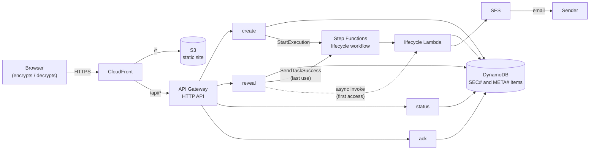
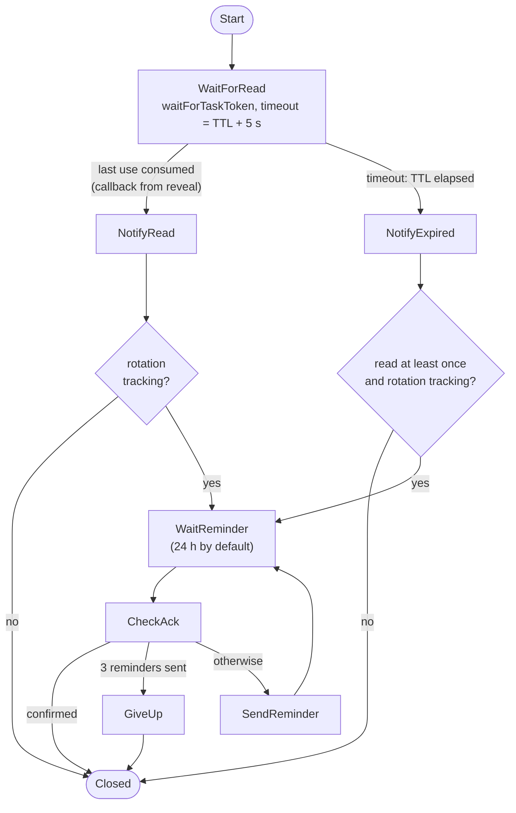

# Cirrus — secrets that dissipate

**English** · [Español](README.es.md)

> Share credentials encrypted in your browser. Cirrus doesn't stop at the link: it tells you when the secret was read and keeps reminding you to rotate the credential until you confirm it.

Built for the AWS Builder Center serverless challenge. Everything runs on managed services: **Lambda, API Gateway, DynamoDB, Step Functions, S3, CloudFront and SES**. There are no servers to patch, no pipelines to maintain, and nothing runs (or bills for compute) while it is idle.

## Why Cirrus

One-time-secret tools solve half of the problem: they make the *link* die after a single read. But when a support engineer sends an IAM access key, a service-account JSON or a `.env` file, the **credential itself stays valid** in the source account, often for months.

Cirrus closes that loop. It recognises what you are sharing, warns you about long-lived credentials, and uses a Step Functions workflow to follow the secret through its life: first access, last read or expiry, rotation checklist, reminders, and confirmation.

## Features

| Area | What it does |
|---|---|
| **Zero-knowledge** | AES-GCM 256 encryption in the browser (WebCrypto). The key travels only in the URL fragment (`#`), which browsers never send to a server. The backend stores ciphertext only. |
| **Atomic multi-use** | 1 to 5 uses per link. Each read is a single conditional `UpdateItem` in DynamoDB, so 10 simultaneous requests against a 3-use secret yield exactly 3 successes. |
| **Real expiry** | 1 minute to 7 days. Expiry is checked against `expiresAt` in the read condition and never relies on DynamoDB TTL (which can lag by hours). |
| **Scanner-safe links** | Opening a link only loads a static page with a *Reveal* button. The secret is consumed by a `POST` triggered by the click, so email security scanners that open links don't burn it. `GET /info` is read-only. |
| **Credential detection** | Entirely client-side. Recognises AWS access keys (`AKIA…`) and temporary credentials (`ASIA…`), GCP service-account JSON, Azure client secrets, GitHub and Slack tokens, PEM private keys, connection strings and `.env` files. Shows a warning, a safer alternative and a shorter default TTL. |
| **Lifecycle tracking** | Opt-in email follow-up: first access (multi-use links), last read, expiry. Optional rotation tracking adds a per-provider checklist, up to 3 reminders, and a confirmation page. |
| **Status page** | The sender sees reads (with timestamps), reminders and rotation state, never the content. |
| **Optional extras** | Passphrase for a second channel (PBKDF2-SHA256, 600,000 iterations), and a plaintext case reference (`CASE-12345`) shown in emails and pages. |
| **Hardened web** | Strict CSP (`script-src 'self'`, no inline code, no third-party resources, self-hosted font), `nosniff`, `no-referrer`, HSTS, `X-Frame-Options: DENY`. |

## Architecture



The site and the API share one origin: CloudFront sends `/api/*` to API Gateway, so no CORS configuration is needed.

| Service | Role |
|---|---|
| **S3 + CloudFront** | Static frontend over HTTPS (WebCrypto requires a secure context), single entry point, security headers. The bucket is private (origin access control). |
| **API Gateway (HTTP API)** | Public endpoints with throttling. |
| **Lambda** (Node.js 22, arm64) | `create`, `reveal`, `status`, `ack` and a multi-action `lifecycle` function. |
| **DynamoDB** (on-demand) | One table, TTL-based cleanup. |
| **Step Functions (Standard)** | Orchestrates the lifecycle: waits for the read without polling, then loops reminders until confirmation. |
| **SES** | Notification emails (HTML and plain text). |

## How it works

### Creating and revealing

1. The browser detects the credential type, generates a random 256-bit key, encrypts, and `POST`s only `ct`, `iv`, TTL and use count. With a passphrase, the plaintext is first encrypted with a PBKDF2-derived key, then wrapped by the random key.
2. The link is `https://<site>/reveal.html#<id>:<key>`. Neither part after `#` reaches the server in a normal request.
3. The recipient opens the link, sees the remaining uses (`GET /info`, read-only), and clicks *Reveal*. The `reveal` Lambda runs one conditional `UpdateItem`: it succeeds only if the item exists, has not expired and has uses left. The last use also deletes the ciphertext.
4. The browser decrypts locally with the key from the fragment.

### The lifecycle workflow

If the sender opts in to follow-up, `create` starts one Step Functions execution per secret.



- **No polling.** The workflow waits with the `.waitForTaskToken` pattern. `reveal` calls `SendTaskSuccess` when the last use is consumed; if the TTL passes first, the task times out and the expiry branch runs.
- **Edge case handled.** If the secret is consumed before the task token is stored, `register` detects it and completes the task itself.
- **Retries.** Every task retries transient Lambda service errors (3 attempts, exponential backoff), so a throttled or unavailable invocation does not silently end the workflow.
- **Bounded.** At most 3 reminders and one final notice; the execution always ends.

When does an email go out?

| Situation | Emails to the sender |
|---|---|
| First access of a multi-use link | One "someone opened your secret" notice (idempotent) |
| Last use consumed | "Read" notice; with rotation tracking: checklist, up to 3 reminders, final notice if unconfirmed |
| Expired with reads | "Expired with N of M reads"; with rotation tracking: checklist and reminders |
| Expired unread | One "expired unread" notice |
| Follow-up not requested | None, and no execution is started |

Rotation checklists include the exact commands for the detected provider (for example `aws iam update-access-key … --status Inactive`, or `gcloud iam service-accounts keys disable …`).

## Data model

One DynamoDB table, partition key `pk`, TTL attribute `ttl`.

| Item | Contents |
|---|---|
| `SEC#<id>` (deleted on the last read) | `ct`, `iv`, `maxUses`, `usesLeft`, `expiresAt`, `pass` (boolean), optional `caseRef` |
| `META#<id>` (kept 30 days after expiry) | `status`, `createdAt`, `reads`, `readLog` (timestamps), `attempts`, hashed status token, ack token, task token, and, only if the sender opted in: `notifyEmail`, `credClass`, `rotate`, and non-secret identifiers (`keyId`, GCP service-account email) |

IDs are 128-bit random values (base64url).

## API

All routes are under `/api` on the same origin as the site.

| Route | Purpose |
|---|---|
| `POST /api/secrets` | Create. Body: `ct`, `iv`, `ttlSeconds` (60 to 604800), `maxUses` (1 to 5), optional `pass`, `caseRef`, `notify` (`email`, `credClass`, `keyId`, `account`, `rotate`). Returns `id` and `statusToken`. |
| `GET /api/secrets/{id}/info` | Remaining uses and expiry. Read-only. Never returns ciphertext. |
| `POST /api/secrets/{id}/reveal` | Consume one use and return `ct` and `iv`. |
| `GET /api/secrets/{id}/status` | Sender's status. Requires the `X-Status-Token` header. |
| `POST /api/ack` | Confirm rotation with the ack token from the email. |

## Security model

**What the server can see:** ciphertext, IV, timestamps, use counters, a "has passphrase" flag, the optional case reference, and, if the sender opts in, their email, the credential class and non-secret identifiers. It never sees plaintext or the key.

**What it protects against**

- A leaked database or logs: only ciphertext is stored; request bodies are never logged.
- Email security scanners: opening a link consumes nothing.
- Concurrent readers: reads are atomic.
- Stale items: expiry is enforced at read time, not by DynamoDB TTL.
- XSS and injection on the web: strict CSP; all dynamic text is inserted with `textContent`.

**What it does not protect against**

- A link intercepted *before* it is read. Mitigate with a passphrase sent through another channel, a single use and a short TTL.
- A compromised sender or recipient device.
- Offline guessing of the passphrase by someone who holds the link (they can fetch the inner blob). Use a long passphrase; the UI enforces at least 12 characters.
- Abuse of the follow-up email feature in production: today SES sandbox only delivers to verified addresses. A production deployment should verify ownership of the notification address.

Cirrus is a demo built for a challenge. Review it before using it for real secrets.

## Cost

Nothing runs when idle, so there are no compute charges without traffic. Lambda, API Gateway, DynamoDB (on-demand) and Step Functions Standard bill per request or per state transition, and CloudFront and S3 bill per request, transfer and storage. An execution with rotation tracking uses about 20 state transitions at most. Use the [AWS Pricing Calculator](https://calculator.aws/) with your expected volume, and check current free-tier terms for your account. Create an AWS Budget alert before deploying.

## Deploy

**Prerequisites:** AWS CLI and SAM CLI configured, Node.js 22, and an email address verified in Amazon SES in `us-east-1` (new accounts start in the SES sandbox).

First time:

```bash
export AWS_PROFILE=<your-profile>     # deploy.sh defaults to "personal" if unset
export AWS_REGION=us-east-1

sam build
sam deploy --guided
```

Answer the prompts:

| Prompt | Value |
|---|---|
| Stack name | `cirrus` (`deploy.sh` expects this name) |
| Region | `us-east-1` |
| `SenderEmail` | your SES-verified address |
| `ReminderWaitSeconds` | `86400` (24 h). Use `30` for a demo. |
| `SiteUrl` | leave empty (set automatically in the next step) |
| Functions "have no authentication. Is this okay?" | `y` (the API is public by design; secrets are encrypted client-side) |

Then:

```bash
./deploy.sh
```

`deploy.sh` builds, deploys, reads the CloudFront URL from the stack outputs, redeploys once if `SiteUrl` changed (so email links point to your site), uploads `web/` to S3 and invalidates CloudFront. Open the printed URL. For later changes, run `./deploy.sh` again, or `./deploy-web.sh` for frontend-only changes.

To remove everything:

```bash
aws s3 rm "s3://$(aws cloudformation describe-stacks --stack-name cirrus \
  --query "Stacks[0].Outputs[?OutputKey=='BucketName'].OutputValue" --output text)" --recursive
sam delete --stack-name cirrus
```

## Develop and test

```bash
npm install          # once: puppeteer-core and axe-core, only for the UI tests
npm test             # unit tests, about 1 second, no network or browser
npm run test:ui      # UI tests in a real Chrome against a simulated API
npm run dev:web      # the site on http://localhost:8080 with a simulated API
npm run preview:emails
```

The unit tests run the real Lambda handlers, the real state machine definition and the real browser modules against a simulated DynamoDB, SES and Step Functions. They check Cirrus's logic, not AWS behaviour (IAM permissions, SES delivery, the real workflow execution); those are verified by deploying. See [`test/README.md`](test/README.md).

## Project layout

```
template.yaml            SAM template (all infrastructure)
statemachine/            Step Functions definition (ASL)
src/
  create/ reveal/ status/ ack/ lifecycle/    one folder per Lambda
web/                     static frontend (no framework, no third-party code)
test/                    unit and UI tests, simulated AWS SDK
deploy.sh                backend + site URL + frontend
deploy-web.sh            frontend only
```

## Limitations and roadmap

- SES sandbox: emails go only to verified addresses, and mail from your own Gmail address through SES may land in spam. A custom domain with DKIM fixes both.
- Anyone can create secrets; there is no sender authentication.
- Single region (`us-east-1`), with one throttle shared by the whole API.
- Roadmap: a CLI for Windows and Linux that reuses the same crypto module, an Outlook add-in, a "request a secret" inbox using public-key encryption (customer to engineer), and verified ownership of notification emails.
